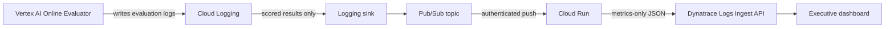

# GCP Agent Evaluation Metrics to Dynatrace

This repository implements a secure, event-driven pipeline that extracts scored
Vertex AI Online Evaluator results from Cloud Logging and sends compact,
dashboard-ready metric records to Dynatrace.

The deployed environment currently monitors:

- GCP project: `scalkit`
- GCP region: `us-east1`
- Agent-quality evaluator: `7464434907389886464`
- Trace safety/hallucination evaluator: `132574714030718976`
- Agent-quality dashboard: [GCP Agent Online Evaluation — Executive Dashboard](https://lqf36699.apps.dynatrace.com/ui/apps/dynatrace.dashboards/dashboard/e80ca032-bd85-41f0-b0d2-a015e6756ff0)
- Trace dashboard: [GCP Agent Trace Evaluation — Executive Dashboard](https://lqf36699.apps.dynatrace.com/ui/apps/dynatrace.dashboards/dashboard/55dd719e-3f16-4575-8a31-0315292915ef)

## Architecture



The deployed GCP resources are:

| Resource | Name | Purpose |
|---|---|---|
| Logging sink | `agent-evaluation-logs` | Select scored results from the configured evaluator |
| Pub/Sub topic | `agent-evaluation-logs` | Decouple log routing from delivery |
| Push subscription | `agent-evaluation-to-dynatrace` | Invoke Cloud Run with OIDC authentication |
| Cloud Run service | `agent-evaluation-to-dynatrace` | Extract and forward metric records |
| Runtime service account | `agent-eval-dt-runtime` | Read the Dynatrace secret |
| Push service account | `agent-eval-dt-push` | Invoke the private Cloud Run service |
| Secret Manager secret | `agent-evaluation-to-dynatrace-platform-token` | Store the Dynatrace Platform token |

The isolated trace-monitor flow adds:

| Resource | Name |
|---|---|
| Logging sink | `agent-trace-evaluation-logs` |
| Pub/Sub topic | `agent-trace-evaluation-logs` |
| Push subscription | `agent-trace-eval-to-dynatrace` |
| Cloud Run service | `agent-trace-eval-to-dynatrace` |
| Push service account | `agent-trace-dt-push` |

Both services reuse the secured runtime identity and Dynatrace secret, but their
log routing, queues, push identities, and Cloud Run scaling are independent.

## Runtime model

Cloud Run is not a one-time job and is not scheduled every 10 minutes. The
pipeline is event-driven:

1. The Online Evaluator performs its evaluation, currently approximately every
   10 minutes.
2. A scored result is written to Cloud Logging.
3. The Logging sink publishes the matching entry to Pub/Sub.
4. Pub/Sub immediately pushes the message to Cloud Run.
5. Cloud Run extracts the metric and sends it to Dynatrace.
6. Cloud Run scales back to zero when no messages are waiting.

If an evaluator run produces no scored result, Cloud Run is not invoked. No Cloud
Scheduler job is required.

## Logging filter

The production sink uses this narrow filter:

```text
resource.type="aiplatform.googleapis.com/OnlineEvaluator"
AND resource.labels.location="us-east1"
AND resource.labels.online_evaluator_id="7464434907389886464"
AND labels."event.name"="gen_ai.evaluation.result"
AND jsonPayload.candidateResult.score:*
```

This excludes heartbeat messages such as `No sessions found`, unscored errors,
and unrelated application logs before they enter Pub/Sub.

The trace-monitor sink uses the same resource, location, and event constraints,
with Online Evaluator `132574714030718976` and the numeric predicate
`jsonPayload.candidateResult.score>=0`. The numeric predicate is required for
this evaluator because Cloud Logging does not match its numeric score field with
the `score:*` existence expression.

## Metric extraction

Cloud Run recognizes the following source evaluation names:

| GCP evaluation name | Normalized key |
|---|---|
| `multi_turn_trajectory_quality_v1` | `multi_turn_trajectory` |
| `multi_turn_task_success_v1` | `task_success` |
| `multi_turn_tool_use_quality_v1` | `tool_use_quality` |
| `tool_use_quality_v1` | `tool_use_quality` |
| `safety_v1` | `safety` |
| `hallucination_v1` | `hallucination` |

Only compact metric data is sent to Dynatrace. Rubric verdicts, reasoning text,
and the complete original GCP LogEntry are not forwarded.

Each Dynatrace record contains:

| Field | Description |
|---|---|
| `evaluation.metric` | Original GCP evaluation name, including the `_v1` suffix |
| `evaluation.metric_key` | Short normalized metric key |
| `evaluation.score` | Evaluation score received from GCP |
| `evaluation.result_id` | Original GCP `insertId`, used for deduplication |
| `evaluation.conversation_id` | Vertex AI conversation identifier |
| `evaluation.online_evaluator_id` | Online Evaluator identifier |
| `evaluation.agent_resource` | Reasoning Engine resource path |
| `gcp.project.id` | Source GCP project |
| `gcp.region` | Source region |
| `gcp.pubsub.message_id` | Delivery message identifier |
| `timestamp` | Original evaluation timestamp |

Pub/Sub provides at-least-once delivery. Dashboard queries therefore deduplicate
on `evaluation.result_id`, so retries or controlled replays do not distort KPIs.

## Dynatrace processing and dashboard

Dynatrace may store attributes received through the Logs Ingest API as strings.
Dashboard queries explicitly use `toDouble(evaluation.score)` before aggregation.
Scores remain stored as values from `0` to `1`; DQL multiplies them by `100` for
percentage presentation.

The agent-quality dashboard uses a fixed 24-hour tile timeframe and includes:

- Trajectory quality percentage
- Task-success percentage
- Tool-use quality percentage
- Overall quality percentage
- Pass rate against an 80% management target
- Total evaluation results
- Unique conversations evaluated
- Below-target result count
- Quality percentage trend
- Quality comparison categorical bar chart
- Target-attainment pie chart
- Evaluation-mix donut chart
- Score-distribution bar chart
- Evaluation-volume timeline
- Recent metric-result table

The version-controlled definition is in
[`dynatrace/agent-evaluation-dashboard.json`](dynatrace/agent-evaluation-dashboard.json).

The separate trace dashboard preserves the same executive layout and visual
style while filtering every query to Online Evaluator
`132574714030718976`. Its headline panels show Safety quality,
Hallucination quality, and overall trace quality as percentages. It also
contains the same management views: pass rate, result and conversation counts,
below-target count, time trend, categorical comparison, donut, pie, score
distribution, volume timeline, and recent-results table.

The trace dashboard is available at [GCP Agent Trace Evaluation — Executive
Dashboard](https://lqf36699.apps.dynatrace.com/ui/apps/dynatrace.dashboards/dashboard/55dd719e-3f16-4575-8a31-0315292915ef), and its version-controlled definition
is [`dynatrace/trace-evaluation-dashboard.json`](dynatrace/trace-evaluation-dashboard.json).

Keeping the dashboards separate prevents safety and hallucination results from
changing the agent-quality KPIs for trajectory, task success, and tool use.

## Prerequisites

- Google Cloud CLI (`gcloud`)
- An authenticated account with permission to manage Cloud Run, Pub/Sub, Cloud
  Logging sinks, IAM, Cloud Build, Artifact Registry, Secret Manager, and service
  enablement in the target project
- A Dynatrace Platform token with `openpipeline:logs:ingest`
- For dashboard API management, the token also needs
  `document:documents:read` and `document:documents:write`
- For external DQL verification, the token/user requires permission to query the
  relevant Grail logs

## Configuration

Create the local environment file:

```bash
cp .env.example .env
```

Required values:

```dotenv
GCP_PROJECT_ID=scalkit
GCP_REGION=us-east1
LOG_FILTER='resource.type="aiplatform.googleapis.com/OnlineEvaluator" AND resource.labels.location="us-east1" AND resource.labels.online_evaluator_id="7464434907389886464" AND labels."event.name"="gen_ai.evaluation.result" AND jsonPayload.candidateResult.score:*'
DT_URL=https://<environment-id>.live.dynatrace.com
DT_PLATFORM_TOKEN=<platform-token>
```

The `.env` file is excluded from Git. Never commit or paste the Platform token
into source code. `DT_URL` may be the environment base URL or the complete
`/api/v2/logs/ingest` URL.

## Authentication

If the default gcloud configuration directory is not writable, use the local,
git-ignored configuration:

```bash
export CLOUDSDK_CONFIG="$PWD/.gcloud"
gcloud auth login
gcloud config set project "$GCP_PROJECT_ID"
```

## Deployment

Deploy or update the complete GCP pipeline:

```bash
chmod +x deploy.sh
./deploy.sh
```

Deploy or update the isolated trace safety/hallucination flow:

```bash
./deploy-trace-monitor.sh
```

The trace deployment defaults to evaluator `132574714030718976`. Its resource
names and evaluator ID can be overridden with the `TRACE_*` environment variables
defined in `deploy-trace-monitor.sh`.

The deployment script:

1. Enables the required GCP APIs.
2. Creates the topic and least-privilege service accounts.
3. Stores the token as a new Secret Manager version.
4. Builds and deploys the Cloud Run container from `app/`.
5. Grants the push identity Cloud Run Invoker access.
6. Creates or updates the authenticated Pub/Sub push subscription.
7. Creates or updates the Logging sink and grants its writer identity Pub/Sub
   Publisher access.

Cloud Run is configured with zero minimum instances, a maximum of 10 instances,
concurrency of 20, and a 60-second request timeout.

## Delivery guarantees and retries

- Pub/Sub acknowledgement deadline: 60 seconds
- Message retention: 7 days
- Minimum retry backoff: 10 seconds
- Maximum retry backoff: 10 minutes
- Successful Dynatrace response: Cloud Run returns HTTP `204`, acknowledging the
  Pub/Sub message
- Network error or non-2xx Dynatrace response: Cloud Run returns HTTP `503`, so
  Pub/Sub retries
- Invalid or non-metric entry: Cloud Run returns HTTP `204` and safely skips it

The maximum 10-minute backoff is a retry limit, not the normal execution
schedule.

## Verification

### Verify the sink

```bash
gcloud logging sinks describe agent-evaluation-logs \
  --project="$GCP_PROJECT_ID"
```

### Verify the push subscription

```bash
gcloud pubsub subscriptions describe agent-evaluation-to-dynatrace \
  --project="$GCP_PROJECT_ID"
```

Confirm that `pushConfig.pushEndpoint` points to the Cloud Run service and that
the OIDC service account is `agent-eval-dt-push@scalkit.iam.gserviceaccount.com`.

### Verify Cloud Run delivery

```bash
gcloud logging read \
  'resource.type="cloud_run_revision" AND resource.labels.service_name="agent-evaluation-to-dynatrace" AND (textPayload:"Forwarded Pub/Sub message" OR textPayload:"Skipped non-metric" OR textPayload:"Dynatrace rejected")' \
  --project="$GCP_PROJECT_ID" \
  --freshness=30m \
  --limit=50
```

Expected successful message:

```text
Forwarded Pub/Sub message id=<message-id> to Dynatrace
```

### Verify records in Dynatrace

```text
fetch logs, from:now()-24h
| filter gcp.project.id == "scalkit" and isNotNull(evaluation.result_id)
| dedup evaluation.result_id
| fields timestamp, evaluation.conversation_id, evaluation.metric,
         score_percent=toDouble(evaluation.score)*100
| sort timestamp desc
```

## Backfill behavior

Cloud Logging sinks route only new matching entries; they do not automatically
backfill historical logs. Historical scored results can be intentionally replayed
through Pub/Sub when required. The dashboard remains accurate because it
deduplicates by the original `evaluation.result_id`.

## Troubleshooting

### Dashboard values are null

- Confirm the tile timeframe includes the original evaluation timestamp.
- Convert scores with `toDouble(evaluation.score)` before `avg`, comparisons, or
  multiplication.
- Confirm records have `evaluation.result_id`; current dashboard panels exclude
  pre-schema test records without it.

### Cloud Run is not invoked every 10 minutes

This is expected when the evaluator produces no scored result. Check Cloud
Logging for heartbeat messages and confirm that a scored
`gen_ai.evaluation.result` exists. The pipeline intentionally ignores heartbeats.

### Messages retry continuously

Search Cloud Run logs for `Dynatrace rejected` or `Dynatrace request failed`.
Confirm that the Platform token is valid, has `openpipeline:logs:ingest`, and that
`DT_URL` targets the correct Dynatrace environment.

### Duplicate Pub/Sub deliveries

At-least-once delivery permits duplicates. Do not use Pub/Sub message ID as the
business identity. Dashboard queries must continue to deduplicate on the original
GCP `evaluation.result_id`.

## Repository layout

```text
.
├── app/
│   ├── Dockerfile
│   ├── main.py
│   └── requirements.txt
├── dynatrace/
│   ├── agent-evaluation-dashboard.json
│   └── trace-evaluation-dashboard.json
├── .env.example
├── deploy.sh
├── deploy-trace-monitor.sh
└── README.md
```
