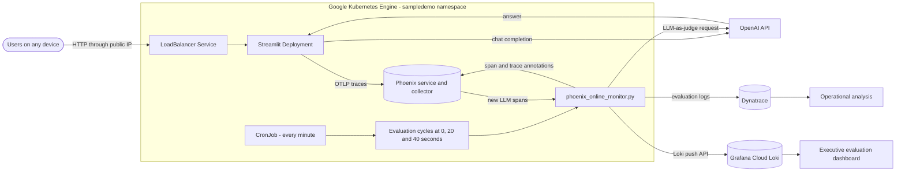
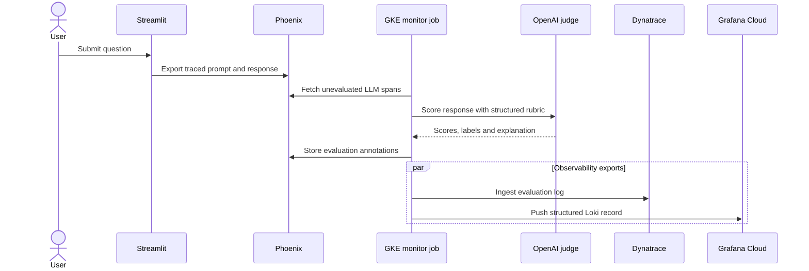

# Sample LLM evaluation application

This repository contains a Streamlit chat application instrumented with
OpenInference. Conversations are traced to Phoenix, evaluated by an online
LLM judge, and exported as operational signals to Dynatrace and Grafana Cloud.

## System architecture



## Evaluation flow



The judge records correctness, hallucination, factuality, relevance, clarity,
safety, completion and supporting quality dimensions. Sampling is deterministic
by span ID, so the same span remains selected or excluded across restarts.

## Local setup

Create and activate a virtual environment, then install dependencies:

```bash
python3 -m venv .venv
. .venv/bin/activate
pip install -r requirements.txt
```

Create `.env` locally. Never commit it. The application and monitor use these
variable groups:

| Destination | Required variables |
|---|---|
| OpenAI | `OPENAI_API_KEY`, optionally `CHAT_MODEL` and `JUDGE_MODEL` |
| Phoenix | `PHOENIX_API_KEY`, `PHOENIX_PROJECT`, `PHOENIX_COLLECTOR_ENDPOINT`, `PHOENIX_API_URL` |
| Dynatrace | `DT_ENV_URL`, `DT_PLATFORM_TOKEN` |
| Grafana Cloud Loki | `GRAFANA_LOKI_URL`, `GRAFANA_LOKI_USER`, `GRAFANA_LOKI_TOKEN` |
| Evaluation | `JUDGE_SAMPLE_PERCENT` |

Start the UI:

```bash
set -a
. ./.env
set +a
.venv/bin/streamlit run app.py
```

Open `http://127.0.0.1:8501` and submit questions to generate traces.

## Generate evaluation traffic

```bash
# Normal conversations
.venv/bin/python generate_conversations.py --count 5

# Deliberately difficult hallucination tests
.venv/bin/python generate_conversations.py --scenario hallucination --count 5

# Six grounded and four ungrounded cases
.venv/bin/python generate_conversations.py --scenario groundedness --count 10
```

Evaluate every eligible span once:

```bash
.venv/bin/python phoenix_online_monitor.py --once --sample-percent 100
```

For ongoing evaluation, set a sampling percentage from `0` through `100`:

```dotenv
JUDGE_MODEL=gpt-4o-mini
JUDGE_SAMPLE_PERCENT=50
```

## Observability

Evaluation records are flattened before export so Loki and Dynatrace can query
fields such as correctness and hallucination labels directly. The Grafana
executive dashboard includes quality index, risk signals, throughput,
hallucination rate, management scorecards, risk trends, and responses requiring
attention.

- [Grafana executive dashboard](https://bhoopeshdevops.grafana.net/d/ai-evaluation-executive/ai-evaluation-executive-dashboard)
- Dashboard source: [`deployment/grafana/executive-dashboard.json`](deployment/grafana/executive-dashboard.json)
- GKE deployment guide: [`deployment/README.md`](deployment/README.md)

Example Dynatrace query:

```dql
fetch logs
| filter `log.source` == "arize.phoenix.evaluations"
| fields timestamp, trace.id, span.id,
    evaluation.correctness.label,
    evaluation.hallucination.label,
    evaluation.relevance.label
| sort timestamp desc
```

## Repository layout

```text
.
├── app.py                              # Streamlit chat UI and tracing
├── generate_conversations.py           # Controlled traffic generator
├── phoenix_online_monitor.py           # Online evaluator and exporters
├── export_evaluations_to_dynatrace.py  # Historical/manual Dynatrace export
└── deployment/
    ├── README.md                        # Complete deployment architecture
    ├── gcp/                             # Images and Kubernetes manifests
    └── grafana/                         # Executive dashboard definitions
```
