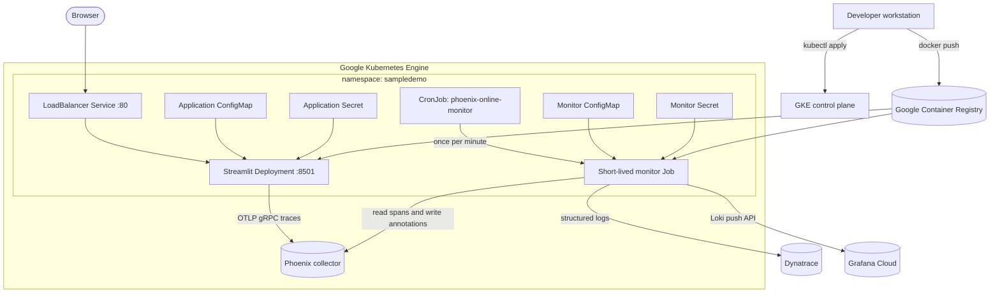
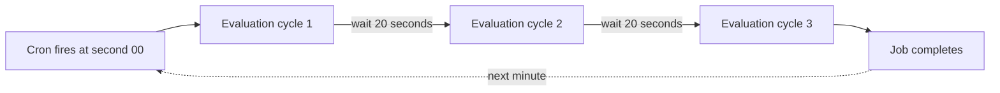
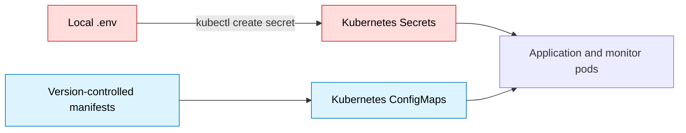

# Deployment architecture and operations

This directory keeps the cloud deployment separate from local runtime files.
It contains independent container builds for the Streamlit application and the
Phoenix online monitor, Kubernetes manifests for GKE, and Grafana dashboard
definitions.

## Deployment topology



## Twenty-second evaluation schedule

Kubernetes CronJob expressions have one-minute precision. The manifest starts
one job every minute; that job runs three bounded evaluation cycles, separated
by 20 seconds.



`concurrencyPolicy: Forbid` prevents overlapping scheduled jobs. Each monitor
run fetches a bounded batch and ignores spans already carrying its evaluation
annotations.

## Artifact map

| Path | Purpose |
|---|---|
| `gcp/Dockerfile` | Streamlit application image |
| `gcp/kubernetes.yaml` | Namespace, application ConfigMap, Deployment and Service |
| `gcp/monitor/Dockerfile` | Online-monitor image |
| `gcp/monitor/cronjob.yaml` | Monitor ConfigMap and CronJob |
| `gcp/monitor/secret.example.yaml` | Placeholder-only Secret example |
| `grafana/folder.json` | Grafana dashboard folder definition |
| `grafana/executive-dashboard.json` | Management and evaluation dashboard |

## Configuration boundary



Credentials belong only in `.env` and Kubernetes Secrets. Endpoint names,
project names, batch size, judge model, and sampling percentage belong in
ConfigMaps. Never commit `.env` or a populated Secret manifest.

## Deploy the Streamlit application

Run from the repository root:

```bash
export IMAGE="gcr.io/scalkit/sampledemo-streamlit:20261111"
gcloud auth configure-docker gcr.io
docker build -f deployment/gcp/Dockerfile -t "$IMAGE" .
docker push "$IMAGE"

set -a
. ./.env
set +a

kubectl create namespace sampledemo --dry-run=client -o yaml | kubectl apply -f -
kubectl -n sampledemo create secret generic sampledemo-secrets \
  --from-literal=OPENAI_API_KEY="$OPENAI_API_KEY" \
  --from-literal=PHOENIX_API_KEY="$PHOENIX_API_KEY" \
  --dry-run=client -o yaml | kubectl apply -f -

kubectl apply -f deployment/gcp/kubernetes.yaml
kubectl -n sampledemo rollout status deployment/sampledemo-streamlit
```

Before applying the manifest in a different environment, update its image tag
and Phoenix collector endpoint.

## Deploy the online monitor

Build and push its separate image when monitor code changes:

```bash
export MONITOR_IMAGE="gcr.io/scalkit/sampledemo-phoenix-monitor:20261112-2"
docker build -f deployment/gcp/monitor/Dockerfile -t "$MONITOR_IMAGE" .
docker push "$MONITOR_IMAGE"
```

Load the current integrations into a Kubernetes Secret without writing their
values to a manifest:

```bash
set -a
. ./.env
set +a

kubectl -n sampledemo create secret generic phoenix-monitor-secrets \
  --from-literal=OPENAI_API_KEY="$OPENAI_API_KEY" \
  --from-literal=PHOENIX_API_KEY="$PHOENIX_API_KEY" \
  --from-literal=DT_PLATFORM_TOKEN="$DT_PLATFORM_TOKEN" \
  --from-literal=DT_ENV_URL="$DT_ENV_URL" \
  --from-literal=GRAFANA_LOKI_URL="$GRAFANA_LOKI_URL" \
  --from-literal=GRAFANA_LOKI_USER="$GRAFANA_LOKI_USER" \
  --from-literal=GRAFANA_LOKI_TOKEN="$GRAFANA_LOKI_TOKEN" \
  --dry-run=client -o yaml | kubectl apply -f -

kubectl apply -f deployment/gcp/monitor/cronjob.yaml
```

If you change an image tag, Phoenix API URL, model, sample percentage, or batch
size, update `gcp/monitor/cronjob.yaml` before applying it.

## Verification and troubleshooting

```bash
# Application health
kubectl -n sampledemo get deployment,service,pods
kubectl -n sampledemo logs deployment/sampledemo-streamlit --tail=100

# Monitor schedule and recent jobs
kubectl -n sampledemo get cronjob phoenix-online-monitor
kubectl -n sampledemo get jobs --sort-by=.metadata.creationTimestamp
kubectl -n sampledemo logs -l app=phoenix-online-monitor --tail=200

# Run one immediate evaluation job
kubectl -n sampledemo create job \
  --from=cronjob/phoenix-online-monitor \
  phoenix-online-monitor-manual
kubectl -n sampledemo logs -f job/phoenix-online-monitor-manual
```

Successful monitor logs should show Phoenix annotations and forwarding results
for both Dynatrace and Grafana Loki. In Grafana, open the
[AI Evaluation Executive Dashboard](https://bhoopeshdevops.grafana.net/d/ai-evaluation-executive/ai-evaluation-executive-dashboard)
and use a recent time range after generating UI traffic.

For component-specific details, see [`gcp/README.md`](gcp/README.md) and
[`gcp/monitor/README.md`](gcp/monitor/README.md).
